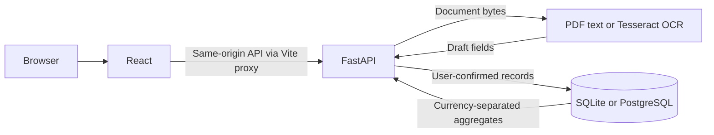
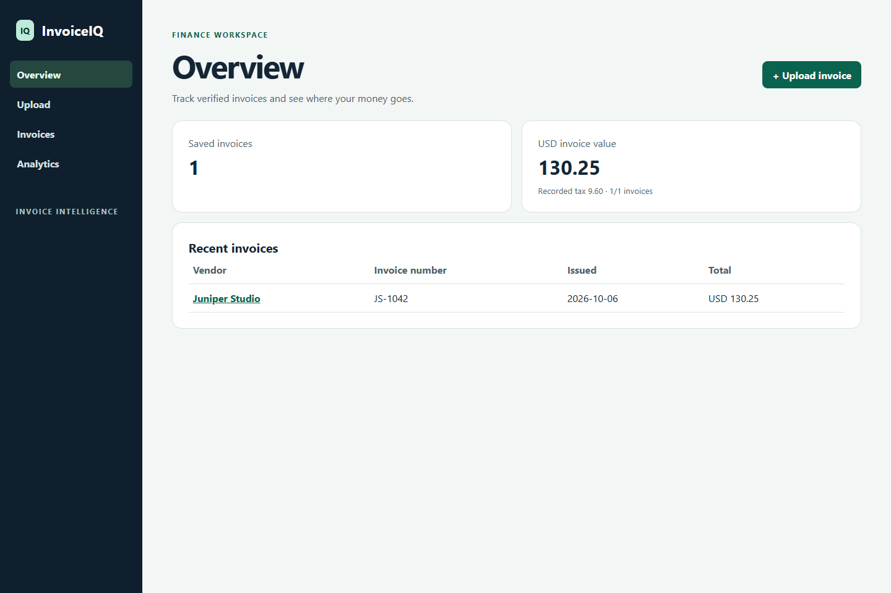
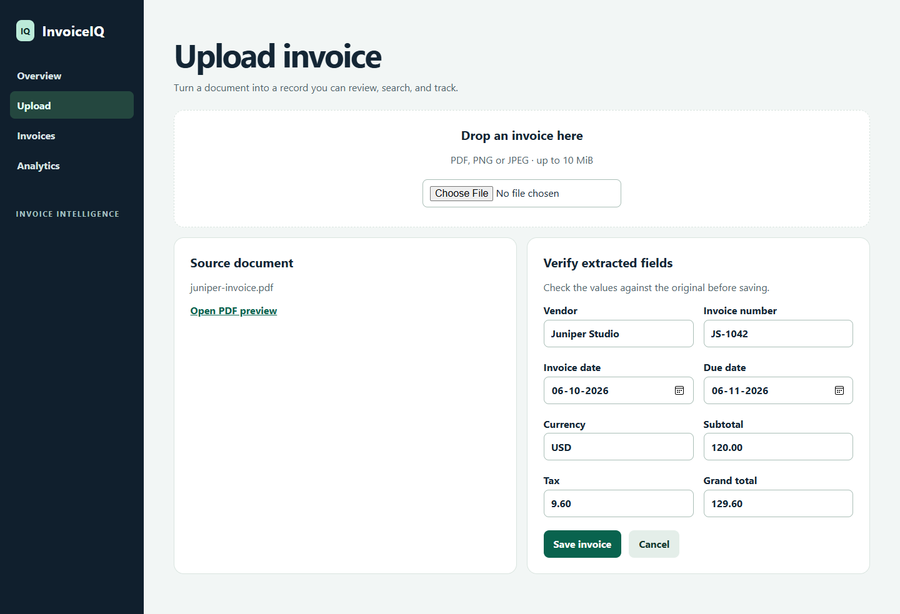

# InvoiceIQ

InvoiceIQ is a local invoice workspace for small businesses and freelancers. Upload an invoice, review the suggested values, and save a searchable record. Analytics group money by currency.

## Run locally on Windows

Requires Python 3.12 and Node.js 24. Run the backend in one PowerShell window from the repository root.

```powershell
cd backend
python -m venv .venv
.venv/Scripts/python.exe -m pip install -r requirements.txt
.venv/Scripts/python.exe -m alembic upgrade head
.venv/Scripts/python.exe -m uvicorn app.main:app --host 127.0.0.1 --port 8000
```

Run the frontend in a second PowerShell window from the repository root.

```powershell
cd frontend
npm.cmd ci
npm.cmd run dev
```

Open [InvoiceIQ](http://127.0.0.1:5173). FastAPI exposes [interactive API documentation](http://127.0.0.1:8000/docs).

## Try the local demo

Open **Upload** and select **Use sample invoice**, or drop the bundled fictional PDF from `sample-data/juniper-invoice.pdf` in local mode. Confirm the extracted invoice number is **JS-1042** and the total is **USD 129.60**, then save. Search for JS-1042 in Invoices, check the USD total in Analytics, and upload the same PDF again to see the duplicate warning.

## Architecture



Set `DATABASE_URL` before running Alembic and starting the API to use PostgreSQL. For OCR, point `TESSDATA_PREFIX` to a directory containing Tesseract English language data (`eng.traineddata`). Extracted fields come from deterministic rules. Blank or ambiguous values need human review.

## Checks

See [Testing](docs/TESTING.md) for backend, migration, and browser checks.

## Security and scope

Local mode accepts PDF, PNG and JPEG documents and processes them in memory. The optional public demo uses the bundled fictional PDF only. Signed, 24-hour browser sessions isolate saved records, CSV exports and analytics. API traffic is rate-limited, and the deployment configuration uses a same-origin HTTPS proxy and verified TLS to PostgreSQL. Public demo mode is for fictional data. See the [deployment guide](docs/DEPLOYMENT.md) for provider setup and the pre-release smoke test.

## License

InvoiceIQ uses the GNU Affero General Public License v3. See [LICENSE](LICENSE).

## Demo screenshots





See the [API reference](docs/API.md), [deployment preparation](docs/DEPLOYMENT.md), and [LinkedIn showcase draft](LINKEDIN_SHOWCASE.md).
