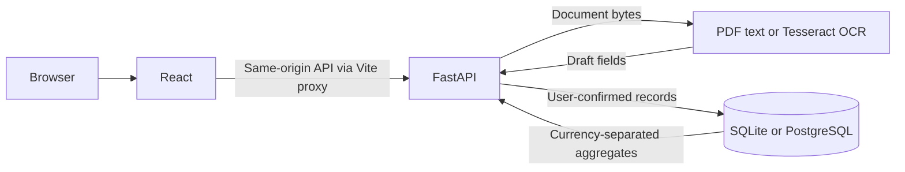

# InvoiceIQ

InvoiceIQ is a local invoice workspace for small businesses and freelancers. Upload an invoice, review the suggested values, and save a searchable record. Analytics group money by currency.

## Run locally on Windows

Requires Python 3.12 and Node.js 24. Run the backend in one PowerShell window from the repository root.

```powershell
cd backend
python -m venv .venv
.venv/Scripts/python.exe -m pip install -r requirements.txt
.venv/Scripts/python.exe -m alembic upgrade head
.venv/Scripts/python.exe -m uvicorn app.main:app --host 127.0.0.1 --port 8000
```

Run the frontend in a second PowerShell window from the repository root.

```powershell
cd frontend
npm.cmd ci
npm.cmd run dev
```

Open [InvoiceIQ](http://127.0.0.1:5173). FastAPI exposes [interactive API documentation](http://127.0.0.1:8000/docs). To generate a fictional invoice, run `backend/.venv/Scripts/python.exe sample-data/make_invoice.py` from the repository root.

## Architecture



Set `DATABASE_URL` before running Alembic and starting the API to use PostgreSQL. For OCR, point `TESSDATA_PREFIX` to a directory containing Tesseract English language data (`eng.traineddata`). Extracted fields come from deterministic rules. Blank or ambiguous values need human review.

## Checks

From `backend`, run `.venv/Scripts/python.exe -m pytest -q`. From `frontend`, run `npm.cmd run build`.

## Security and scope

The current application is intended for local use. Source documents are processed in memory, and only confirmed invoice fields are persisted. The API has no user accounts or tenant isolation. Public hosting requires authentication, authorization, rate limits, and document processing isolation. Use fictional invoices for demos.

## License

InvoiceIQ uses the GNU Affero General Public License v3. See [LICENSE](LICENSE).

## Demo screenshots


See the [API reference](docs/API.md), [testing instructions](docs/TESTING.md), [deployment preparation](docs/DEPLOYMENT.md), and [LinkedIn showcase draft](LINKEDIN_SHOWCASE.md).
